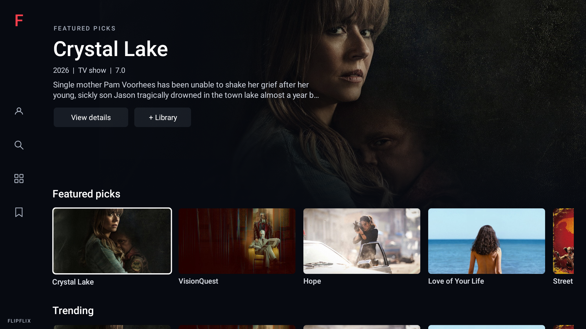
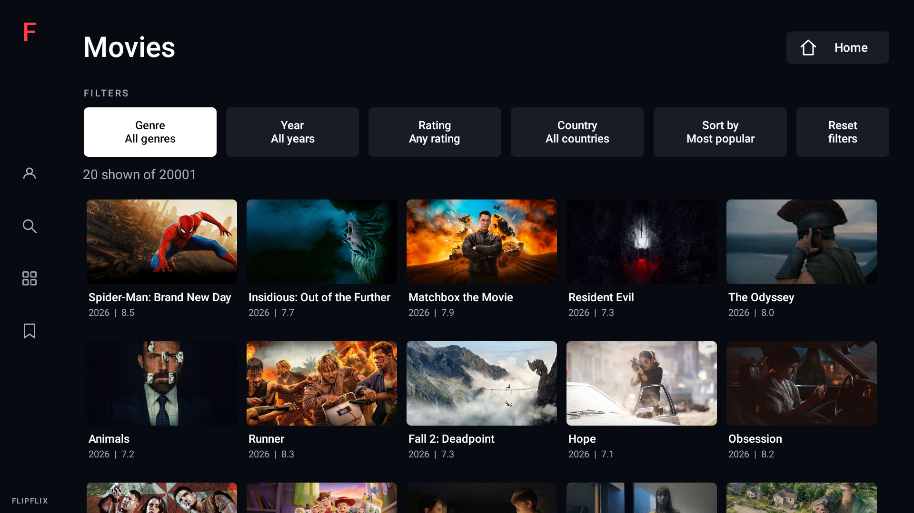

# Flipflix research prototype

Flipflix is a separate, native Android TV / Fire TV catalog prototype. It tests how much of a streaming website can be recreated with native remote navigation while leaving playback in a third-party embedded video frame.

Download the latest APK: https://tinyurl.com/24qywecz



## What works

- A cinematic native discovery Home with a persistent profile/search/browse/library rail, shared artwork hero, and horizontal rows. The hero occupies the upper 55% and keeps title information visible while rows scroll beneath it
- Featured picks, Trending, Movies, TV Shows, Crime TV, Comedy TV, a mixed-size Spotlight, Recently added movies, Comedy movies, Anime, and Live Sports. Rows fetch more pages near the end and keep later selected cards near the left content edge
- Home cards use 16:9 artwork with labels below, about four complete cards plus a partial next card on a 1080p TV. Spotlight combines a wide promotion and taller posters. Collection and search grids use the same artwork-first cards and labels beneath, five across. White rounded focus borders have room on every edge
- Horizontal page changes, vertical page/row navigation, and season choices glide into place with a 220-320ms decelerating animation at the normal system animation scale. Focus changes immediately; repeated presses retarget from the current position instead of queuing animations. Home headings stay visible with their row, final cards remain whole, and motions are cancelled when leaving a screen or starting a touch gesture
- Selectable row headings open full-page collection grids with a Load more control. The shared rail appears on Home, Library, collections, search, and details. Browse offers direct Home, Movies, TV Shows, Trending, Anime, Live Sports, and Library destinations. Movies/TV Shows headings also show a Browse & filter hint. Search is available from the rail and existing collection headers
- Movies and TV Shows have native remote-friendly Genre, Year, Minimum rating, Country, and Sort by menus plus Reset filters. Combine filters across the full catalog, with Most popular, Highest rated, Newest first, or Oldest first sorting. Movie year means original release year; TV year means first aired. Each section remembers its own choices across details, playback, and app restarts; Home rows stay unfiltered
- Left/Right moves between filter buttons, OK opens a selection list, Back cancels it, and Down enters results. Up from the first card row returns to the last-used filter. Loading, no matches, and retry states never trap remote focus. Changing filters resets pagination and ignores late responses from the previous query
- To find filters: select Browse (the four-square icon on the left rail), then Movies or TV Shows. Genre, Year, Rating, Country, and Sort are under FILTERS at the top. Left from the first filter/card enters the rail; Right restores that filter/card. Menu opens Browse on collection/search/details screens; on Home it still focuses the active category heading
- Left/Right moves cards; Up/Down changes rows and remembers each row's last card. Left at the first card enters the rail; Right returns. Up from the first row selects the hero actions. Menu focuses the current row heading; Up/Down on headings selects other headings, Right enters cards, and OK opens the section. Mouse hover selects, click/OK opens, and native touch scrolling remains available
- The shared hero immediately follows selection. Licensed Sintel and Big Buck Bunny sample trailers play muted after 1.5 seconds idle, fading in only after a decoded frame is actually playing. Cards, hero text, and rail remain visible. Selection changes cancel timers and release the old player; missing/broken previews retain artwork. Backgrounding, dialogs, and reduced-motion settings suspend automatic playback. These are replacement open-film assets, not Flipflix originals
- The local Library saves/removes titles on this device. Local profile changes a device-only display name and offers media credits; it is not an online account or sign-in service
- Predictable D-pad navigation across poster rows and a high-contrast TV focus state
- Native title details, TV seasons, and episode selection
- Movie and series details show their genres beside the year, type, and rating. Known catalog genres appear immediately and are refreshed by the existing details request; missing genres are omitted, with no extra network requests or polling
- Edge-to-edge title artwork behind the detail screen, with readable text and source buttons layered over a soft dark gradient
- Movie and series details automatically look up official English YouTube trailers (or teasers) using the title's TMDB ID after a short idle delay. A small top-center "Preview is loading..." label appears in unused header space during startup, clear of movie controls and series episode/season rows. Actual YouTube PLAYING events trigger a 400ms eased crossfade from the artwork/controls to an unobstructed YouTube player with sound. The player starts unmuted at full player volume; the TV's system volume and mute are unchanged, and remote volume keys work normally. No guessed buffering percentage or scrolling-card video downloads
- Arrow, OK, Back, or a media key pauses the preview and smoothly restores the artwork and controls without accidentally activating a source; the next press works normally. After 3 seconds with no remote input, the same player resumes with sound and fades the controls away once playback actually starts. Every press/release resets the delay, and held buttons prevent restarting. Initial playback and replay after the trailer ends also wait 3 seconds. Missing/unavailable trailers, blocked autoplay, startup/rebuffer timeouts, and unsupported WebViews leave the normal page usable without retry loops. Dialogs suspend the timer until dismissed; leaving the page, starting a movie, or backgrounding the app releases the preview. System reduced-motion settings disable automatic previews
- Bolt, Rift, and Fast choices directly on the title screen, before playback
- Rift attempts native HLS/MP4 playback when it advertises a direct stream, with an embedded fallback if native playback fails. Bolt and Fast use embedded players
- Sports listings with a native wrapper around the observed embed provider. Sports load the provider directly, without an outer iframe. A narrow compatibility fix handles embed.st's failed inline-PDF probe, which otherwise misidentifies Android WebView as a sandboxed iframe. It does not remove sandbox attributes, disable actual iframe restrictions, intercept video requests, or scan the DOM. Remote Back returns to Live Sports
- Sports automatically attempt to start the provider's JW Player when ready. Startup uses a bounded set of checks over 20 seconds, stops after a start attempt, and never continually clicks or overrides later pauses. Flipflix's native Play button and the remote Play key can retry before video metadata exists; no pointer is needed for the initial Play screen
- TV launcher entry, no touchscreen requirement, landscape layout
- Playback is always fullscreen with a compact Netflix-inspired timeline and icon row. There is no separate windowed player, permanent header, or episode footer. The controls hide after **5 seconds without remote input**, even while a button has focus. Arrow or OK reveals them without accidentally activating the selected action. Menus stay open while choosing an option
- Play/pause, back/forward 10 seconds, mute, subtitles, video quality, previous/next episode, source, retry, and Close player. Up focuses the timeline; left/right on the timeline seeks 10 seconds; Down returns to the buttons. Dedicated remote media keys also work in fullscreen
- A Fill screen / Fit picture button beside Close player. Fill scales the video proportionally and crops the edges to cover the player; Fit restores the whole picture. Each new playback starts in Fit. Native playback uses Media3's crop mode; accessible embedded videos use reversible, video-only styling, without changing page zoom or scaling the Android view. Bars encoded into the video itself may remain
- Rift direct streams use Media3/ExoPlayer with native captions and supported quality tracks. Embedded sources use a small, event-driven HTML video bridge, with no continuous DOM scanning. Subtitle and quality choices come from the actual stream/provider, not a hard-coded list. When a provider does not expose an option, the menu explains that limitation
- Remote Back or Close player stops playback and returns directly to the title details (or Live Sports). Back inside a source/settings menu only dismisses that menu. Pop-up windows and top-level off-site navigation are suppressed

The app reads public catalog responses from `pantyflix.com` and poster images from TMDB. These are third-party services that may change or restrict access. Crime TV and Comedy TV are genre collections, not live channels; no broadcast schedules or progress values are invented. Recently added movies uses release date sorting, not a provider's ingestion timestamp. Live Sports receives an ON NOW badge; its data does not supply a program progress bar. The reusable model supports broadcast time, age rating, episode text, progress, and title logos when a source supplies them. The Anime row uses a broad animation discovery query, not the exact website anime catalog. Online account features are not implemented. Native Rift playback depends on the provider continuing to expose a compatible stream and the TV supporting its codec. Embedded controls require a compatible Android System WebView and an accessible HTML video in an allowed provider frame. Nested players on other domains, DRM/custom players, or unavailable provider tracks may limit control. On older WebViews without document-start injection, the provider loads directly and the bridge attaches after the page finishes loading.

This is an educational prototype, not an official Pantyflix client. Metadata, artwork, branding, and streams must be used under their respective permissions and terms before any broader distribution.

### Trailer previews

There are two intentionally different preview modes. `DiscoveryView` uses one `AmbientPreview` Media3 player behind the browsing UI. Only titles with a licensed direct `previewUrl` participate; currently those are the bundled Blender sample trailers. Ordinary catalog titles retain their poster in Home, and continue to offer the existing YouTube preview on their details screen. YouTube streams are not extracted or used as wallpaper beneath app UI. See `app/src/main/assets/open-films/LICENSE.txt` for sample sources and attribution.

The discovery player is muted, has a 1.5-second cancelable idle delay, bounded startup timeout, 25-second excerpt, generation/identity checks on callbacks, and no polling. Remote selections, mouse hover, and touch gestures share the same current selection. A failed/missing clip leaves the poster intact, and returning from details restores the selected row/card. The Android animator-duration setting is used as the native reduced-motion preference. No browser or CSS zoom is involved.

`TrailerPreview` uses the existing public catalog proxy's `/api/tmdb/movie/{id}/videos` or `/api/tmdb/tv/{id}/videos` response. It selects at most three deduplicated, valid YouTube IDs marked official, preferring English trailers over teasers. It never searches by title or extracts direct YouTube streams. The standard YouTube IFrame Player API retains its controls, attribution, aspect ratio, and advertisements. Branding, titles, source buttons, loading label, and both gradients disappear after playback starts; remote interaction pauses the preview before bringing app chrome back. Loading the embedded player shares playback information with YouTube; no API credentials or account login are bundled.

Only the app-owned top-level HTML document at the Android application identity origin can report events through the origin-scoped message bridge; provider subframes have no native API access. One resettable native idle timer controls playback, with bounded startup/rebuffer timeouts and no polling or DOM scans. A paused details preview retains its player and playback position, avoiding repeated metadata requests or WebView reloads. Late readiness/playing events cannot override active remote input. Returning after leaving the page creates a new preview. Old WebViews without message-listener support keep artwork instead. Live availability still depends on YouTube, the catalog entries, region, and the device's WebView. Direct access to TMDB outside this prototype's existing proxy requires an appropriate API key and attribution.

### Sports compatibility notes

The observed `Remove sandbox attributes on the iframe tag` warning comes from a hidden `object#sandDetect` PDF failing to load, not an iframe added by Flipflix. `sports-compat.js` only handles that exact PDF error on a top-level HTTPS `embed.st/embed/` page; real iframes, other documents, and unrelated errors are left alone. Current WebViews install the handler at document start. Older WebViews insert it into this provider's initial HTML before its scripts, preserving response security headers and leaving media traffic untouched.

This fixes the false warning, not all provider/browser incompatibilities. The API 30 TV emulator's WebView 90 also fails on the provider's newer WebAssembly code, so removing the warning there does not prove live-video playback. Live playback still depends on a sufficiently current WebView, a working provider stream, and supported codecs. No WebView engine or device-wide settings are bundled or changed by this update.

`sports-start.js` is limited to the same top-level sports documents. It targets JW Player's documented `jwplayer('player').play()` API, with a fallback to the observed JW display Play button inside `#player`. It never taps arbitrary screen coordinates or advertisement links. A rejected autoplay can be retried from the native Play control; provider or network failures still require Retry or another stream. The early-injection path works on old WebViews as well as those supporting document-start scripts.

## Visual styling

All app-owned screens share the discovery palette through `AppStyle`: near-black/navy #070A11, white and cool-gray type, muted navy panels, translucent buttons with white focused states, modest 5dp corners, and a restrained red accent. `NavigationRail` is shared across browsing screens. Collections, search, details, episodes, source/filter dialogs, and playback controls follow the same typography and focus language. Detail artwork uses the same left/bottom gradient composition as Home. Video surfaces and system bars stay true #000000; fullscreen playback has no rail, and all app chrome (including the rail) disappears during YouTube details previews. Embedded provider content is not restyled. Android system sans-serif fonts substitute for proprietary fonts. TV card focus uses a white rounded outline and slight emphasis. The supplied attachment was a still photo, not a video; motion follows the written specification rather than a frame-by-frame video match. Flipflix keeps its own name and existing feature set.



## TV scrolling

The scrolling behavior follows the focus-aware alignment and bounded-pending-movement principles used by [Android Leanback](https://developer.android.com/reference/androidx/leanback/widget/BaseGridView) and [DpadRecyclerView](https://rubensousa.github.io/DpadRecyclerView/recipes/scrolling/). Discovery uses a left-anchored carousel with one shared hero; existing collection grids retain their paging behavior without migrating to either library.

`TvScrollMotion` animates only scroll offsets using Android's frame-synced `ValueAnimator`, which honors the system animation scale. There are no timers running while idle and no per-frame layout or network operations. `TvHorizontalScrollView` and `TvScrollView` suppress the framework's immediate focus-reveal jump, retain focus bookkeeping, and animate a single current destination. The vertical scroller groups Home headings with their carousel. Initial layout and explicitly immediate visibility requests remain immediate; regular remote navigation animates. Appending catalog pages preserves the current focus and does not restart an unchanged destination.

## Build instructions

The shared SDK is `/home/okonu/Android/Sdk`. No SDK copy is stored in this project.

```sh
ANDROID_HOME=/home/okonu/Android/Sdk ./gradlew assembleRelease
```

APK: `app/build/outputs/apk/release/app-release.apk`

This experimental release variant is non-debuggable but signed by the local Android debug key. Keep that key for installable updates; a production app should use a dedicated release key. GitHub releases use the asset name `app-release.apk`, allowing a stable `/releases/latest/download/app-release.apk` download URL.

## Playback regression tests

`DiscoveryTest` verifies selected-card/hero consistency, per-row memory, rail and clickable heading navigation, intermediate scroll frames, whole focus outlines, viewport clipping, hover/click, touch scrolling on both axes, a compact landscape layout, saved Library, actual muted native video decoding after idle, rapid-selection cancellation, stale-player disposal, missing-file poster fallback, hidden-screen cleanup, restored focus, and reduced-motion behavior. The media fixtures are the same licensed local trailers shipped in the app, so these tests do not rely on a third-party stream being live.

`PlaybackControlsTest` runs on the Android TV emulator. It covers focused-button timeout, wake without accidental activation, D-pad seeking, menu timeout suspension, native playback/seek/mute/captions/track selection, remote Fit/Fill toggling and native crop geometry, an actual HTML video controlled and resized through the WebView message bridge, whole-card carousel pages/top-border clipping, and opening every Home heading with the remote. The fixture is test-only and is not shipped in the release APK.

`SportsCompatibilityTest` checks strict URL scoping, early script ordering, suppression of only the known PDF error, and preservation of unrelated errors and iframe behavior. Startup fixtures also cover delayed JW readiness, one-shot activation, exact Play targeting without ad clicks, bounded retries, cancellation, autoplay rejection, and native Play before video metadata or bridge messages exist. These run in the emulator's real WebView with a deterministic clock; they do not claim that a third-party live stream is available.

`PlayerNavigationTest` exercises the real Activity: fullscreen-only movie/TV/sports playback, single-Back return, source/menu/episode/retry navigation, native-video geometry and cleanup, provider custom fullscreen transitions, and rejection of late callbacks after closing playback.

`CatalogFiltersTest` covers movie/series query parameters, saved choices, remote filter menus, focus with empty/loading/error states, filtered pagination, reset, stale response rejection, and detail-screen genre metadata using a deterministic catalog fixture. It also verifies direct Browse-to-Movies/TV routing, cancel/return focus, rail-to-card/filter round trips, shared screen styling, and 16:9 artwork with unclipped labels below.

`TvScrollingTest` checks actual intermediate scroll frames, monotonic movement, quick direction changes, whole cards at rest, simultaneous vertical/horizontal movement, heading visibility, pagination during animation, season choices, and cancellation when a screen is removed. It runs on the TV emulator with deterministic native-view fixtures.

`TrailerPreviewTest` exercises the real WebView wrapper/message bridge, sound-enabled startup, system volume-key passthrough, official trailer selection, loading label, PLAYING-gated fade, animated return, key-up/held-key consumption, focus restoration, repeated 3-second idle resumes using the same player, deferred initial lookup and late responses, replay after completion, dialog suspension, failures/timeouts, lifecycle cleanup, and subframe-message rejection. Its optional `liveYouTubeProbe` diagnostic runs only when passed `-Pandroid.testInstrumentationRunnerArguments.liveTrailer=<YouTube ID>` and reports observed live playback separately from deterministic regression assertions. Adding `-Pandroid.testInstrumentationRunnerArguments.requireLiveAudio=true` asserts that the actual YouTube player reaches PLAYING with mute off and nonzero player volume; it does not measure sound from a physical TV's speakers. `-Pandroid.testInstrumentationRunnerArguments.requireLiveResume=true` also sends a remote press and verifies that the same live player resumes after the idle delay.

```sh
ANDROID_HOME=/home/okonu/Android/Sdk ANDROID_SERIAL=emulator-5554 ./gradlew connectedDebugAndroidTest
```
