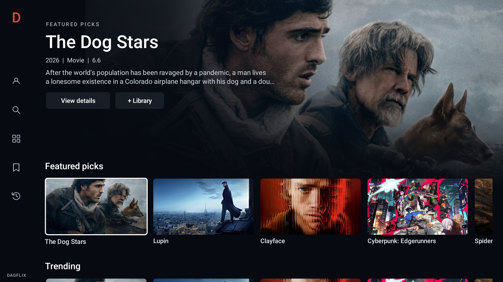
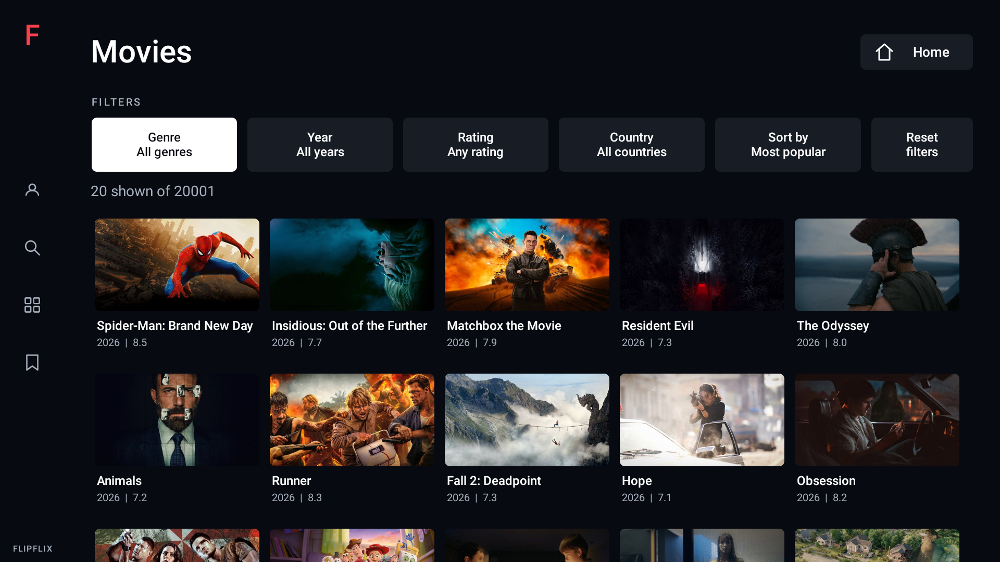

# Darkflix

Darkflix (formerly Dagflix and Flipflix) is a native Android TV / Fire TV discovery app with remote-friendly browsing, title details, trailers, Library, watch history, and third-party playback providers.

This is an experimental project. Favor small, fast iterations and checks scoped to the behavior being changed, on the actual TV unless requested otherwise. The owner permits resetting/reinstalling this app and discarding its test data when useful; do not add data-preservation or migration work by default. This does not authorize deleting unrelated projects or device data.

Download the latest APK: https://tinyurl.com/24qywecz

The GitHub repository and releases are public. The stable short link targets the latest `app-release.apk`.

## ExoPlayer-only native playback (v0.1.32)

- ExoPlayer is the only native player. VLC, its binaries, dependencies, fallback, selector and bundled notices have been removed. Startup audio and optional direct ambient previews also use ExoPlayer. The vector intro, eight-second timing and final crossfade remain.
- `PlaybackBackend` is the shared controls interface; native and provider adapters report their real capabilities and receive the same commands. Native uses Media3 1.5.1, retaining Android 5.1/API 22 support. Native failures are bounded and leave Source, Retry and Back available; there is no automatic switch to Web.
- Full HLS master URLs are preserved, including separate audio and caption renditions. Native controls offer Auto and the supported video variants, actual audio languages, available captions/Off, mute, pause, accelerating seek and Fit/Fill. A one-quality stream is identified honestly instead of inventing quality options. Stale menu selections cannot act on a replacement session.
- New native sessions start unmuted at full player volume. History/resume remains shared across providers and Native/Web modes. Codec support now depends on ExoPlayer and the device decoders; removing VLC can reduce support for unusual formats. No FFmpeg extension is bundled.
- Production catalog, provider Web input, YouTube trailers and sports routes are unchanged. The test-only HLS fixture has two video renditions, two synthesized audio tracks and rendered captions; it never ships in the release APK.

Verification on 2026-11-09: 19 focused deterministic checks passed across targeted runs on the physical onn TV over wireless ADB, plus a live Rift / Code 3 probe. These cover actual audio decoding/output, mute/unmute, quality and audio-track selection, rendered captions, paused seek, accelerating remote seek, cross-provider resume, stale menus, fullscreen/Back, failure cleanup, previews and startup audio/crossfade. The fullscreen check caught ExoPlayer's unused hidden control buttons; a controller-free player layout fixed it, and the four affected rendering/track tests passed again. No emulator or full-suite run was used.

Live Code 3 exposes a one-variant HLS manifest: 480p HEVC video and AAC audio. ExoPlayer played it, decoded/output audio, acknowledged mute/unmute, sought to one minute and paused. An initial probe incorrectly required multiple qualities; inspecting the manifest established the single-variant source, and the final probe explicitly verified that limitation. Multi-quality selection is verified by the deterministic HLS fixture, not claimed for this live stream. No signed URLs were saved. Release build/lint (zero errors, 74 warnings), APK signing and 16 KB ZIP alignment passed; the dependency graph and packaged code contain no VLC, and test media is absent from the release.

## Explicit Native / Web playback (v0.1.31, historical)

- Movie and episode details offer Bolt - Native, Rift - Native, Fast - Native and a second row of their Web choices. The in-player source picker groups each provider's Native/Web pair. Native always uses VLC; Web always keeps the provider player. Neither mode switches engines automatically on success or failure. Source, Retry and Back remain accessible when native resolution fails.
- Web mode gives D-pad, OK and media-key input directly to the provider. Darkflix does not hide its controls or draw a duplicate playback overlay. Back/Menu opens a small app menu for returning to the player, changing source/mode, retrying, starting over, moving episodes or closing playback. The provider must support keyboard/remote input; this is not a virtual mouse or a guarantee that every provider widget is keyboard accessible.
- Progress remains keyed by movie/episode, independent of provider or mode. The saved preference retains all six choices, and switching between Web and Native carries the same checkpoint. Provider message APIs and the existing media-state bridge track progress without taking control of the Web UI.
- New VLC sessions explicitly initialize output to 100% player volume and unmuted. A deliberate mute still works within that session; it is not inherited by the next source. The hidden discovery WebView remains muted separately. This does not invent an audio track when a provider stream lacks one or change the TV's system volume.
- Stable stored IDs are Native Bolt/Rift/Fast = 0/1/2 and Web Bolt/Rift/Fast = 3/4/5. Existing stored provider IDs select Native. Sports retains its existing playback route.

Live check on 2026-11-05: Minions & Monsters (2026, catalog ID 1315772) advanced in Bolt Web mode on the actual onn TV. Bolt Native did not reach VLC: the exact provider frame displayed `net::ERR_SSL_PROTOCOL_ERROR`. A later Web attempt showed the same connection error, so it is not confined to the hidden native resolver. Another native retry crashed inside `libwebviewchromium.so` before a usable native-audio result. Do not describe Bolt-native audio as verified or fixed from these checks. Signed stream URLs and provider credentials are not retained in this report.

Eight focused physical-TV regression checks passed across targeted runs: six stable choices, explicit engine ownership with real iframe remote input, Web-mode history/checkpoint sharing, Back/Menu/source-picker focus, episode/retry navigation, immediate resume across all six modes, native cross-provider resume without inheriting mute, and actual VLC audio decoding/output plus pause/seek/mute/Fit-Fill. The audio test waits for VLC's output-volume acknowledgement during a seek instead of reading the old output synchronously. Release build/lint (0 errors, 72 warnings), signature and 16 KB ZIP alignment passed. Temporary WebView inspection hooks and ADB port forwarding were removed. The generated updater-test fixture was restored. The owner explicitly requested publication and TV installation of this experimental version with the live-provider limitations above; this release does not claim to fix Bolt-native audio.

## Rift native audio fix (v0.1.30, historical)

- Root cause: Rift's HLS loader preloads the master playlist without making a Resource Timing entry. The previous discovery heuristic selected a later video-only child playlist, losing the separate audio rendition. The master observed on the TV contains three video levels and AAC audio; this was a source-selection error, not a VLC codec or mute-setting problem.
- Discovery now observes HLS.js's public [media attachment](https://hlsjs.video-dev.org/api-docs/hls.js.hls.attachmedia), associates each instance with its exact video element, and hands VLC that instance's [current input URL](https://hlsjs.video-dev.org/api-docs/hls.js.hls.url). It preserves the original method's arguments and result, rejects detached owners, and restores the method on handoff. If a known HLS player has no usable input URL, discovery does not substitute a guessed video child.
- The observer runs on library/media events, not a polling loop. No extra manifest requests, guessed provider endpoints, payload decryption, persisted stream tokens, or player-engine changes were added. Rift remains native-only; Bolt's existing web fallback remains.
- Both the original live audio test and a deterministic real-WebView test failed before this fix and passed afterward on the actual onn TV box over wireless ADB. The WebView regression uses a closure-private HLS instance, an unrelated second player, a preloaded master absent from Resource Timing, and a visible video-only child. The live Rift/Sintel test requires a selected native audio track, decoded-audio and played-audio-buffer counters, mute/unmute, seek and pause. This verifies delivery to Android's audio output, not physical speaker loudness or every provider title.

Five focused TV checks passed across two runs: live Rift native audio/controls, the master-selection regression, scoped one-shot discovery/stale-session rejection, cross-provider native resume, and Bolt web recovery/audio after a native failure. Release build/lint (zero errors, 72 warnings), signing and 16 KB ZIP alignment passed. No emulator or full-suite run was used.

## Native-only Rift, Bolt web fallback (v0.1.29, historical)

- Rift now uses a hidden, non-focusable, muted WebView only to discover an ordinary direct stream. VLC is its only playback backend. Rift's old provider controller and web-player fallback are not instantiated. Fast and sports retain their existing routes.
- Bolt keeps its visible web player when a usable direct URL cannot be discovered. If a discovered stream plays in VLC, native playback takes over. If that native attempt fails, Bolt returns once to web playback at the shared resume point, without a discovery/retry loop. Explicit Retry or selecting a source permits a fresh attempt.
- The entire resolver WebView is muted with AndroidX's [WebView audio API](https://developer.android.com/reference/androidx/webkit/WebViewCompat#setAudioMuted(android.webkit.WebView,boolean)), including nested frames. It cannot open a fullscreen/custom view or take remote focus. Its clock cannot update watch history or replace a saved resume point.
- Rift discovery has a 45-second limit. Failure or unsupported WebView capabilities leaves Source, Retry and Back available, with no web fallback. Retry creates a new discovery lease; late results/timeouts from old leases are ignored. A successful handoff stops/blanks the resolver before VLC starts and restores the shared movie/episode checkpoint.
- Rift resolution requires document-start scripts, origin-scoped messages, and WebView audio muting. Older Fire TV WebViews lacking these features cannot resolve Rift natively; Bolt/Fast retain web playback. A title may also fail if its provider does not expose a usable direct URL. No DRM, authentication, or provider protection is bypassed, and signed URLs are not persisted.
- This release changed playback policy, not stream selection. Its Rift video-only HLS input issue was subsequently fixed in v0.1.30 above. Only tracks available in the direct stream can appear in native controls.

Live verification on the actual onn TV: Sintel on Rift reached VLC with 885-second metadata and acknowledged a seek to one minute and pause. Bolt did not resolve in the observed attempt; a subsequent switch to Rift must not be counted as Bolt success. Live audio was not verified in these resolver checks. Keep tests narrow; no emulator or full-suite run is needed for this policy change.

Five focused regression checks passed across targeted TV runs: Rift control ownership/fullscreen rejection; timeout/retry/source/episode/Back navigation; scoped one-shot discovery; native cross-provider resume; and Bolt recovery after an actual VLC failure, including restored WebView audio and the shared checkpoint. The final fallback test passed in 6.9 seconds. Embedded documents can report `about:blank` from `getUrl()` when their history URL is null, so audio restoration uses their completed-page callback URL. Release build/lint (zero errors, 72 warnings), signing and 16 KB ZIP alignment passed.

## VLC-native playback (v0.1.28, historical)

- All native movie/episode sessions, the startup soundtrack, and optional direct background previews use bundled LibVLC 3.7.7. ExoPlayer and all Media3 dependencies have been removed completely; there is no engine-switch retry step. YouTube/provider web integrations are unchanged.
- Hardware decoding is enabled with software fallback permitted. Fullscreen playback renders through SurfaceView; ambient previews use TextureView for their crossfade. This is a compatibility choice, not a claim of lower CPU, RAM, or power use than ExoPlayer; actual resource use depends on the device and codec.
- The existing TV controls, cross-provider history/resume, accelerating seek, mute, subtitles, available audio tracks, Fit/Fill, and Back behavior remain. VLC reports automatic adaptive quality rather than exposing unsupported manual quality choices. Only one native engine is active per session, and release/failed sessions cannot restart.
- A 25-second preparation limit leaves Source, Retry, and Back accessible on failure. No external VLC app is needed. Provider Web routes and sports remain unchanged when no usable direct URL is exposed.
- This engine change does not fix stream discovery's separate video-only-playlist problem observed on the onn TV with Rift. An audio-free input still has no audio in VLC; the provider's complete video/audio source must be resolved separately. Do not infer live-provider audio success from fixture tests.
- Native regression tests now assert actual VLC audio decoding/output counters and engine volume, plus paused seeks, subtitles, real Fit/Fill surface geometry, cross-provider resume, lifecycle cleanup, and failure behavior. The non-silent Sintel fixture is debug-only, not release catalog content. The optional live probe accepts `requireAudio=true` to require decoded/output audio in addition to advancing video.

Verification on 2026-10-29: the final, focused ten-test run passed on the actual onn 4K TV box over wireless ADB, using the isolated `.validation` package. It covers decoded audio and mute, pause/seek, captions and Fit/Fill, cross-provider resume, failed-session cleanup, fullscreen/Back, preview recovery and rapid selection, plus the eight-second startup crossfade and audio-focus loss. Keep future regression runs scoped to changed behavior rather than rerunning the entire suite by default. Test settings/history are separate from the installed app.

The TV checks caught two issues before release: a reused preview TextureView could prevent the next VLC session from starting, so each preview now owns a fresh video surface; and a mute assertion needed to wait for VLC's actual volume acknowledgment during a seek. Startup vectors follow a monotonic clock anchored to VLC's Playing event because VLC's audio-only time value stalled on the bundled clip. No temporary diagnostic logging remains. These fixture checks do not establish audio availability for every live provider.

The signed universal release passed lint (zero errors, 71 warnings), signature and 16 KB ZIP-alignment checks. APK inspection confirms LibVLC is present and ExoPlayer/Media3 and debug-only sample media are absent. Package/signing identity and minimum Android 5.1/API 22 remain unchanged.

## Native-first playback (v0.1.27, historical)

- Movie/episode playback observes the selected provider's normal video loading. If that exact provider frame exposes an ordinary HTTPS video or HLS/DASH manifest and full-length metadata, Darkflix stops the web player and hands playback to native Media3/ExoPlayer. It does not decrypt provider payloads, guess protected endpoints, bypass DRM, or persist stream tokens.
- ExoPlayer tries available platform decoders first. Unsupported audio, player errors, or a bounded preparation timeout switch once to the bundled LibVLC 3.7.7 native engine, which supplies broader audio/video decoding. No external VLC installation is required. LibVLC is the extra codec path; this release does **not** build or bundle Media3's separate FFmpeg audio extension.
- Both native engines use the existing Darkflix remote controls, accelerating seek, pause/play, mute, Fit/Fill, subtitle and source-provided audio-track choices. ExoPlayer exposes available video-quality tracks; VLC uses automatic adaptive quality. Provider-only server lists, styling, or separate language-version features may be unavailable after native handoff.
- History is still keyed by movie/episode, not provider or engine. Handoff captures progress before releasing the outgoing backend. Exo-to-VLC fallback preserves the current position, pause, mute and Fit/Fill. Back releases both engines; leaving the Activity pauses native playback.
- The controls identify the active engine: `Bolt / ExoPlayer`, `Rift / VLC`, or `Fast / Web`, for example. If no usable URL is exposed, the existing web integration remains and is explicitly labeled Web. Sports stays on its existing route. Once native playback starts, a failure does not silently return to an embed or loop indefinitely: Source, Retry and Back remain available.
- Discovery is event-driven, source-origin/session scoped, and cancelled on source change/exit. Short clips, DRM signals, stale documents, ambiguous cross-host manifests, and materially mismatched native durations are rejected. It depends on WebView document-start/message support; older WebViews retain the Web route. This cannot guarantee a direct stream for every provider or title.
- Compile SDK 36 and AGP 8.10.1 support the current stable LibVLC dependency. Minimum Android remains 5.1/API 22 and target API remains 33. ARMv7, ARM64, x86 and x86_64 are packaged; the universal APK is larger because it now includes actual native codec libraries. All SDK packages remain in `/home/okonu/Android/Sdk`.
- Software notices and LGPL/Apache license texts are available under Profile > Media credits > Software licenses, with upstream source/build links.

`NativeFirstPlaybackTest` checks actual Exo and VLC decoding, real decoder failure/fallback, paused-position/mute/crop preservation, bounded failure, scoped discovery and stale-session rejection, and Activity-level cross-provider native handoff/history. Its opt-in `liveNativeProbe` takes `nativeProvider=0`, `1`, or `2`; `requireNative=true` distinguishes confirmed native playback from a working web fallback. Fixture/protocol tests do not establish live-provider availability.

Verification on 2026-10-28: the API 34 TV emulator regression suite passed 130 tests, with four optional live probes skipped. A subsequent seven-test native suite, including background handoff and a live Rift probe using the licensed film Sintel, also passed. Rift exposed a full-length stream that played in ExoPlayer; seeking to 60 seconds, pausing, and forcing a switch to VLC preserved the paused position. Both rendered screenshots show the same app-owned controls with no duplicate web controls: [ExoPlayer](docs/screenshots/native-rift-exoplayer.png), [VLC](docs/screenshots/native-rift-vlc.png). Sintel is (c) Blender Foundation, licensed CC BY 3.0; these are test captures, not seeded catalog entries. Live Bolt/Fast native availability was not established by this check.

Release lint completed with zero errors (75 warnings), and the signed universal release APK passed signature and ZIP alignment checks. Minimum SDK 22 and the existing package/signing identity are unchanged. This verifies the API 34 emulator path, not playback on every older Fire OS version or every codec/device combination.

## Darkflix name (v0.1.26)

- The launcher, system app name, in-app branding, update prompts, and playback help now say Darkflix, matching the existing geometric icon and startup logo.
- This is an in-place update. The package `com.okonu.flipflix`, signing certificate, local storage, repository, and stable download URL stay unchanged, preserving settings, Library, watch history, and automatic updates. The internal `DagflixBolt` bridge identifier is deliberately unchanged; it is not displayed to viewers.

## Matching launcher artwork (v0.1.25)

- The launcher icon now uses the exact red geometric emblem from the approved Darkflix startup, centered on pure black without small lettering, borders, or a second background. Native vector paths stay sharp at launcher sizes.
- Android 8+ receives an adaptive icon with the complete emblem inside the circular safe zone; older Fire OS/Android versions retain a vector fallback. A monochrome layer supports themed launchers on compatible non-TV devices.
- The 16:9 TV banner uses the approved emblem and Darkflix wordmark. This artwork update does not rename the installed Dagflix app or change its package, signing key, playback, startup, or stored history.
- Android-rendered assets: [launcher icon](docs/screenshots/app-icon.png) and [TV banner](docs/screenshots/tv-banner.png). `LauncherArtworkTest` checks the exact startup paths, adaptive mask, circular safe zone, black background, and readable banner wordmark.

## Vector startup intro (v0.1.24)

- The approved Darkflix geometric logo and lettering are native Android vector paths, not a low-resolution video. All pieces fade in together and assemble with slow-fast-slow motion, settling on the soundtrack's impact at 4.2 seconds. Rendering follows the app surface resolution, including 1080p/4K surfaces where the device supplies them.
- The eight-second intro has no skip button or remote shortcut. Home loads underneath it. During the final second, the entire animation layer fades to transparent over Home while the approved soundtrack fades to silence. There is no intermediate black screen, video decoder, WebView, or startup network dependency.
- Remote/touch input cannot activate Home underneath the intro. Input focus returns after the layer is removed. Update prompts and ambient previews wait until it finishes. Leaving the app releases startup audio immediately; returning or recreating the Activity does not replay it. The OS reduced-motion setting disables the decorative sequence. Media failures fail open to Home, with a bounded watchdog.
- The existing Dagflix application name, package, signing certificate, watch history, and stable download link are preserved. [Startup media credits and implementation](STARTUP_MEDIA.md) document the approved artwork and soundtrack.
- `StartupIntroTest` exercises the real audio-clock/vector sequence, complete crossfade, non-skippable input, held-key handoff, lifecycle/recreation, error recovery, reduced motion, update deferral, and vector geometry at 720p, 1080p, and 4K. Other instrumentation tests omit startup via a debug-only test runner. `tools/check_startup_media.py` checks vector assets, eight-second audio, impact alignment, headroom, and the silent tail.

## Live catalog cleanup (v0.1.23)

- Removed the permanently seeded Sintel/Big Buck Bunny entries from Featured picks and Spotlight and the unused demo-only fullscreen route. Their artwork/trailers now live in debug-only assets, not the release APK.
- Existing Library entries with the exact legacy keys `open:sintel` or `open:bunny` are removed on read. Real TMDB entries with those names, other bookmarks, profile settings, and all watch history are retained.
- Featured and Spotlight use live daily/weekly catalog results. Home refreshes when revisited after one hour, without background polling. Spotlight opens its own weekly collection. New releases accurately describes release-date sorting and excludes future original release dates.
- Media credits now describe the actual catalog, artwork, trailer, and sports services. Local profile remains explicitly device-only. Unavailable catalogs show an error rather than substituting sample content.
- Verification: 108 emulator tests passed, three optional live-provider probes skipped; release lint and signed build passed. A live release-APK smoke check showed current catalog titles and artwork, not sample cards. The release APK is about 4 MB instead of 14 MB, retains Android 5.1 support and the existing signing certificate, and contains no test/demo media.
- Dialog tests now wait for the actual Android window to own input and for the expected button/list option to be selected. A repeated source-menu test reproduced the old test harness sending Down before window focus transferred; the product's playback behavior did not need a change.

## Dagflix and Bolt handoff (v0.1.22)

- The launcher, in-app branding, D monogram, and update prompts now say Dagflix. The package `com.okonu.flipflix`, signing key, local preferences, GitHub repository, and stable download link deliberately stay unchanged so an in-place update preserves history and Library.
- `BoltPlayback` listens to [Bolt's documented playback messages](https://vidbolt.pro/) in an origin-, frame-, and session-scoped wrapper. Progress no longer depends solely on finding a readable HTML video inside the provider. The existing DOM bridge still supplies supported subtitle, quality, and sizing options. Play/pause/seek use the documented provider commands, and startup receives the shared resume timestamp. No new DOM scans, background network requests, or polling are added.
- The regression fixture sends real cross-origin Bolt messages through the production Activity, switches to Rift, and verifies an acknowledged seek and persistent history. The old implementation failed this test because it ignored those messages. This verifies the integration contract, not the availability of every live stream; direct access to the live Bolt host failed TLS from this development machine.
- Slow source preparation no longer exhausts the resume timeout before the first seek. Once the source can seek, retries and acknowledgement remain bounded; failed restoration keeps the shared checkpoint. This uses the existing foreground state-sampling loop, not additional provider/network polling.
- Back during source-menu focus transfer now dismisses the menu instead of accidentally closing the movie. A deterministic regression reproduces that input race before the fix.
- Verified on the API 34 TV emulator: 100 tests passed, three optional live-provider probes skipped; release lint and signed APK build passed. The TV was checked over ADB and had v0.1.21 before this update, matching the published release at the time.


## One playback surface and shared resume (v0.1.21)

- Rift now shows Flipflix's compact playback controls by default. A narrowly scoped, document-start stylesheet hides only Rift's observed control containers, including the center buttons and pause card. Video, captions, loading messages, and playback errors remain visible. No new polling or persistent DOM observer is added.
- Playback settings > Use Rift player controls restores that provider's controls and hides Flipflix's. Back/Menu returns to Flipflix. Old WebViews that cannot inject into the provider frame use provider-only controls; Back exits playback there. Bolt and Fast retain their existing integrations.
- Hiding the controls parks remote focus on a nonvisual native container, not the WebView. Android's full-video focus highlight is disabled. The timeline uses a red focus thumb rather than a white rectangular panel; controls retain the shared white icons, compact focused buttons, and black fading background.
- Resume uses a content-keyed repository plus a provider-independent recovery coordinator over interchangeable `PlaybackBackend` adapters. One movie or episode has one checkpoint shared by Bolt, Rift, and Fast; the last provider is only a preference, not part of the key. Source handoff saves before teardown. If the outgoing source loses metadata or reports a short ad, the last confirmed checkpoint survives. Rapid switches carry the pending position until a ready player acknowledges the seek. Unsupported seeking keeps the saved progress and explains the limitation. Different cuts of a movie can have different timelines; timestamps cannot guarantee identical scenes.
- Opening a watched movie from browsing goes straight to its shared checkpoint using the last source; selecting a source or episode also checks the same checkpoint and resumes automatically, without a blocking choice dialog. A compact Start from beginning action sits above the timeline and hides with the other controls. Press Up from the timeline to reach it. Restart clears the shared checkpoint before seeking, so a stale outgoing clock cannot restore the old position. New titles keep their details/preview screen. Back from resumed playback returns to details so you can still browse sources, without immediately reopening playback.
- The bundled Big Buck Bunny sample is normalized from 853 to 854 pixels wide for decoders that reject odd-width H.264. Audio and attribution are retained; no provider streams are modified.
- Verified on the API 34 Android TV emulator (WebView 113): 94 regression tests passed, three optional live-provider probes skipped, release lint/build passed. The checks include automatic cross-provider resume, restart with stale clocks, the actual Activity source-switch path, exclusive Rift controls through iframe reloads, retained captions/errors, custom fullscreen focus, and a captured Start from beginning layout. This does not claim live playback of every provider/title.

## Source button styling (v0.1.20)

Bolt, Rift, and Fast now share the same dark idle styling on movie and series details. Only the remote-focused button turns white; moving focus to Back or another source restores Bolt's dark background. The first source still receives initial focus, without a permanent primary-action highlight.

## Updates, resume, and history (v0.1.19)

- The new clock icon below Library opens History. Bookmarks stay separate. History keeps up to 300 movies/individual episodes on this device, newest first, with artwork and progress. Selecting an entry directly resumes that episode using its last source. Back returns to History.
- Starting a previously watched title now resumes automatically (updated in v0.1.21); Start from beginning is a nonblocking playback action. Near-complete titles remain in History as Finished and start over. Movies and each season/episode have separate records; switching source or retrying carries the current position.
- Progress is saved every five seconds during playback and when leaving/backgrounding the player. This samples already-received Java player state, without extra network requests, JavaScript polling, or DOM scans. Resume waits for seekable metadata and acknowledgement, makes at most three seek attempts, and retains the old bookmark if a provider cannot seek. Live sports, previews, and short advertisement frames are excluded. Progress depends on a source exposing usable video state; Rift uses its official API. A forced kill or power cut may lose the most recent few seconds. History is local, not synced between TVs, and cannot recover viewing that happened before this feature was installed.
- Automatic updates check the public [GitHub latest-release API](https://docs.github.com/en/rest/releases/releases#get-the-latest-release) when the app is foregrounded, at most once every six hours. Offline failures back off for 15 minutes. No always-running background service, GitHub credentials, or silent installations are used. Browse > App updates allows a manual check.
- A newer stable release's `app-release.apk` downloads privately. Its SHA-256 digest, package name, version code/name, and signing certificate must match before installation. Draft/prerelease, older, incomplete, wrong-package, or wrong-key APKs are rejected. Only HTTPS GitHub download hosts are accepted. A verified pending download survives app/TV restarts.
- The install prompt waits until you leave playback. Later snoozes it for 24 hours; App updates can reopen it immediately. Android 8+ may ask you to allow Flipflix to install unknown apps. Android/Fire TV still displays its own installation confirmation; the app does not bypass that requirement. Older Fire OS uses the system installer/unknown-sources setting. The APK is shared only with a temporary read grant through [FileProvider](https://developer.android.com/reference/androidx/core/content/FileProvider), not broad storage access.
- Install v0.1.19 once to gain automatic updates; earlier Flipflix versions do not contain this updater. Future releases must increase both numeric `vX.Y.Z` and Android versionCode, keep the same signing key/package, and upload `app-release.apk` with a GitHub SHA-256 digest. The stable TinyURL remains unchanged.
- Audio language/dubbing choices are supplied by the current source, using its track labels, not a fixed list of languages. Rift also exposes source/language versions when provided; availability can differ by title and source.
- Verified on the actual onn TV box over wireless ADB: 85 regression tests passed, three optional live probes skipped, release lint/build passed. Separate live Rift tests restored playback at 2:00. Update tests verified a signed higher-version fixture and the install-permission return path without changing the TV's security settings.



## What works

- A cinematic native discovery Home with a persistent profile/search/browse/library rail, shared artwork hero, and horizontal rows. The hero occupies the upper 55% and keeps title information visible while rows scroll beneath it
- Featured picks (daily trends), Trending, Movies, TV Shows, Crime TV, Comedy TV, a mixed-size Spotlight (weekly movie trends), New releases, Comedy movies, Anime, and Live Sports. Every production row is populated by its catalog endpoint; there are no bundled recommendations. Rows fetch more pages near the end and keep later selected cards near the left content edge. Clicking Spotlight opens the matching weekly movie collection.
- Home cards use 16:9 artwork with labels below, about four complete cards plus a partial next card on a 1080p TV. Spotlight combines a wide promotion and taller posters. Collection and search grids use the same artwork-first cards and labels beneath, five across. White rounded focus borders have room on every edge
- Horizontal page changes, vertical page/row navigation, and season choices glide into place with a 220-320ms decelerating animation at the normal system animation scale. Focus changes immediately; repeated presses retarget from the current position instead of queuing animations. Home headings stay visible with their row, final cards remain whole, and motions are cancelled when leaving a screen or starting a touch gesture
- Selectable row headings open full-page collection grids with a Load more control. The shared rail appears on Home, Library, collections, search, and details. Browse offers direct Home, Movies, TV Shows, Trending, Anime, Live Sports, and Library destinations. Movies/TV Shows headings also show a Browse & filter hint. Search is available from the rail and existing collection headers
- Movies and TV Shows have native remote-friendly Genre, Year, Minimum rating, Country, and Sort by menus plus Reset filters. Combine filters across the full catalog, with Most popular, Highest rated, Newest first, or Oldest first sorting. Movie year means original release year; TV year means first aired. Each section remembers its own choices across details, playback, and app restarts; Home rows stay unfiltered
- Left/Right moves between filter buttons, OK opens a selection list, Back cancels it, and Down enters results. Up from the first card row returns to the last-used filter. Loading, no matches, and retry states never trap remote focus. Changing filters resets pagination and ignores late responses from the previous query
- To find filters: select Browse (the four-square icon on the left rail), then Movies or TV Shows. Genre, Year, Rating, Country, and Sort are under FILTERS at the top. Left from the first filter/card enters the rail; Right restores that filter/card. Menu opens Browse on collection/search/details screens; on Home it still focuses the active category heading
- Left/Right moves cards; Up/Down changes rows and remembers each row's last card. Left at the first card enters the rail; Right returns. Up from the first row selects the hero actions. Menu focuses the current row heading; Up/Down on headings selects other headings, Right enters cards, and OK opens the section. Mouse hover selects, click/OK opens, and native touch scrolling remains available
- The shared hero immediately follows selection, with catalog artwork and metadata. Home keeps the poster when there is no licensed direct preview URL. Details retain their existing title-specific YouTube trailer lookup. No demonstration films or unrelated videos are substituted.
- The local Library saves/removes titles on this device. Local profile changes a device-only display name and offers media credits; it is not an online account or sign-in service
- Predictable D-pad navigation across poster rows and a high-contrast TV focus state
- Native title details, TV seasons, and episode selection
- Movie and series details show their genres beside the year, type, and rating. Known catalog genres appear immediately and are refreshed by the existing details request; missing genres are omitted, with no extra network requests or polling
- Edge-to-edge title artwork behind the detail screen, with readable text and source buttons layered over a soft dark gradient
- Movie and series details automatically look up official English YouTube trailers (or teasers) using the title's TMDB ID after a short idle delay. A small top-center "Preview is loading..." label appears in unused header space during startup, clear of movie controls and series episode/season rows. Actual YouTube PLAYING events trigger a 400ms eased crossfade from the artwork/controls to an unobstructed YouTube player with sound. The player starts unmuted at full player volume; the TV's system volume and mute are unchanged, and remote volume keys work normally. No guessed buffering percentage or scrolling-card video downloads
- Arrow, OK, Back, or a media key pauses the preview and smoothly restores the artwork and controls without accidentally activating a source; the next press works normally. After 3 seconds with no remote input, the same player resumes with sound and fades the controls away once playback actually starts. Every press/release resets the delay, and held buttons prevent restarting. Initial playback and replay after the trailer ends also wait 3 seconds. Missing/unavailable trailers, blocked autoplay, startup/rebuffer timeouts, and unsupported WebViews leave the normal page usable without retry loops. Dialogs suspend the timer until dismissed; leaving the page, starting a movie, or backgrounding the app releases the preview. System reduced-motion settings disable automatic previews
- Bolt, Rift, and Fast each have explicit Native and Web choices directly on the title screen and in the source picker. Native uses ExoPlayer after bounded, muted stream discovery; Web uses the provider's own inputs without automatic native handoff
- Sports listings with a native wrapper around the observed embed provider. Sports load the provider directly, without an outer iframe. A narrow compatibility fix handles embed.st's failed inline-PDF probe, which otherwise misidentifies Android WebView as a sandboxed iframe. It does not remove sandbox attributes, disable actual iframe restrictions, intercept video requests, or scan the DOM. Remote Back returns to Live Sports
- Sports automatically attempt to start the provider's JW Player when ready. Startup uses a bounded set of checks over 20 seconds, stops after a start attempt, and never continually clicks or overrides later pauses. Flipflix's native Play button and the remote Play key can retry before video metadata exists; no pointer is needed for the initial Play screen
- TV launcher entry, no touchscreen requirement, landscape layout
- Playback is always fullscreen with a compact Netflix-inspired timeline and icon row. There is no separate windowed player, permanent header, or episode footer. The controls hide after **5 seconds without remote input**, even while a button has focus. Arrow or OK reveals them without accidentally activating the selected action. Menus stay open while choosing an option
- Play/pause, accelerating back/forward seek, mute, subtitles, video quality, playback settings, previous/next episode, source, retry, and Close player. Up focuses the timeline; Down returns to buttons. Hold Left/Right on the timeline, hold OK on a seek icon, or use the remote rewind/fast-forward keys. Quick repeated taps also accelerate: 10 seconds initially, 30 seconds after 1 second, 60 after 2.5 seconds, and 120 after 5 seconds. A 900ms pause, direction change, or leaving the seek control restores fine steps. Commands are rate-limited to one per 180ms and accumulate against the intended target, not stale player reports
- A Fill screen / Fit picture button beside Close player. Fill scales the video proportionally and crops the edges to cover the player; Fit restores the whole picture. Each new playback starts in Fit. Native playback uses ExoPlayer's proportional zoom mode; accessible embedded videos use reversible, video-only styling, without changing page zoom or scaling the Android view. Bars encoded into the video itself may remain
- Native playback offers supported subtitle/audio tracks and video-quality variants exposed by its direct stream. Web mode retains the provider's own subtitles, quality, server and language controls where available. No languages or resolutions are invented; resolution is not a CAM/HD source-type indicator
- In Web mode, Back/Menu opens Darkflix's playback-options menu, including source/mode selection and Close playback. Provider pop-ups remain suppressed; provider keyboard support and WebView capabilities still determine which web inputs can be used with the remote
- Remote Back or Close player stops playback and returns directly to the title details (or Live Sports). Back inside a source/settings menu only dismisses that menu. Pop-up windows and top-level off-site navigation are suppressed

The app reads public catalog responses from `pantyflix.com` and artwork from TMDB. These are third-party services that may change or restrict access. Home fetches on creation, then refreshes on the next return to Home (or foreground return while on Home) after one hour. There is no periodic/background catalog poll and no refresh during playback or details. Fresh rows replace the old in-memory catalog, and late responses for discarded rows are ignored. Crime TV and Comedy TV are genre collections, not live channels; no broadcast schedules or progress values are invented. New releases sorts by original release date, capped at today's date; it does not claim provider-added dates or streaming availability. Live Sports receives an ON NOW badge; its data does not supply a program progress bar. The Anime row uses an animation/Japanese-language discovery query. Local profile is device-only, not an online sign-in. Playback and track options depend on the provider, WebView, and device codecs.

This is an educational prototype, not an official Pantyflix client. Metadata, artwork, branding, and streams must be used under their respective permissions and terms before any broader distribution.

### Trailer previews

`DiscoveryView` retains its optional `AmbientPreview` support for licensed direct preview URLs, but the production catalog currently supplies none: Home displays title artwork, never an unrelated sample video. Movie and series details use their existing TMDB/YouTube trailer lookup. YouTube streams are not extracted or used as wallpaper beneath app UI. The Blender media used by deterministic playback tests is under `app/src/debug/assets/open-films/`, including its license and attribution; it is not packaged in release APKs.

The discovery player is muted, has a 1.5-second cancelable idle delay, bounded startup timeout, 25-second excerpt, generation/identity checks on callbacks, and no polling. Remote selections, mouse hover, and touch gestures share the same current selection. A failed/missing clip leaves the poster intact, and returning from details restores the selected row/card. The Android animator-duration setting is used as the native reduced-motion preference. No browser or CSS zoom is involved.

`TrailerPreview` uses the existing public catalog proxy's `/api/tmdb/movie/{id}/videos` or `/api/tmdb/tv/{id}/videos` response. It selects at most three deduplicated, valid YouTube IDs marked official, preferring English trailers over teasers. It never searches by title or extracts direct YouTube streams. The standard YouTube IFrame Player API retains its controls, attribution, aspect ratio, and advertisements. Branding, titles, source buttons, loading label, and both gradients disappear after playback starts; remote interaction pauses the preview before bringing app chrome back. Loading the embedded player shares playback information with YouTube; no API credentials or account login are bundled.

Only the app-owned top-level HTML document at the Android application identity origin can report events through the origin-scoped message bridge; provider subframes have no native API access. One resettable native idle timer controls playback, with bounded startup/rebuffer timeouts and no polling or DOM scans. A paused details preview retains its player and playback position, avoiding repeated metadata requests or WebView reloads. Late readiness/playing events cannot override active remote input. Returning after leaving the page creates a new preview. Old WebViews without message-listener support keep artwork instead. Live availability still depends on YouTube, the catalog entries, region, and the device's WebView. Direct access to TMDB outside this prototype's existing proxy requires an appropriate API key and attribution.

### Sports compatibility notes

The observed `Remove sandbox attributes on the iframe tag` warning comes from a hidden `object#sandDetect` PDF failing to load, not an iframe added by Flipflix. `sports-compat.js` only handles that exact PDF error on a top-level HTTPS `embed.st/embed/` page; real iframes, other documents, and unrelated errors are left alone. Current WebViews install the handler at document start. Older WebViews insert it into this provider's initial HTML before its scripts, preserving response security headers and leaving media traffic untouched.

This fixes the false warning, not all provider/browser incompatibilities. The API 30 TV emulator's WebView 90 also fails on the provider's newer WebAssembly code, so removing the warning there does not prove live-video playback. Live playback still depends on a sufficiently current WebView, a working provider stream, and supported codecs. No WebView engine or device-wide settings are bundled or changed by this update.

`sports-start.js` is limited to the same top-level sports documents. It targets JW Player's documented `jwplayer('player').play()` API, with a fallback to the observed JW display Play button inside `#player`. It never taps arbitrary screen coordinates or advertisement links. A rejected autoplay can be retried from the native Play control; provider or network failures still require Retry or another stream. The early-injection path works on old WebViews as well as those supporting document-start scripts.

## Visual styling

All app-owned screens share the discovery palette through `AppStyle`: near-black/navy #070A11, white and cool-gray type, muted navy panels, translucent buttons with white focused states, modest 5dp corners, and a restrained red accent. `NavigationRail` is shared across browsing screens. Collections, search, details, episodes, source/filter dialogs, and playback controls follow the same typography and focus language. Detail artwork uses the same left/bottom gradient composition as Home. Video surfaces and system bars stay true #000000; fullscreen playback has no rail, and all app chrome (including the rail) disappears during YouTube details previews. Rift's duplicate control containers are hidden only while Flipflix owns playback input; its video, captions, loading UI, and errors are unchanged. Android system sans-serif fonts substitute for proprietary fonts. TV card focus uses a white rounded outline and slight emphasis. The supplied attachment was a still photo, not a video; motion follows the written specification rather than a frame-by-frame video match. Flipflix keeps its own name and existing feature set.



## TV scrolling

The scrolling behavior follows the focus-aware alignment and bounded-pending-movement principles used by [Android Leanback](https://developer.android.com/reference/androidx/leanback/widget/BaseGridView) and [DpadRecyclerView](https://rubensousa.github.io/DpadRecyclerView/recipes/scrolling/). Discovery uses a left-anchored carousel with one shared hero; existing collection grids retain their paging behavior without migrating to either library.

`TvScrollMotion` animates only scroll offsets using Android's frame-synced `ValueAnimator`, which honors the system animation scale. There are no timers running while idle and no per-frame layout or network operations. `TvHorizontalScrollView` and `TvScrollView` suppress the framework's immediate focus-reveal jump, retain focus bookkeeping, and animate a single current destination. The vertical scroller groups Home headings with their carousel. Initial layout and explicitly immediate visibility requests remain immediate; regular remote navigation animates. Appending catalog pages preserves the current focus and does not restart an unchanged destination.

## Build instructions

The shared SDK is `/home/okonu/Android/Sdk`. No SDK copy is stored in this project.

```sh
ANDROID_HOME=/home/okonu/Android/Sdk ./gradlew assembleRelease
```

APK: `app/build/outputs/apk/release/app-release.apk`

This experimental release variant is non-debuggable but signed by the local Android debug key. Keep that key for installable updates; a production app should use a dedicated release key. GitHub releases use the asset name `app-release.apk`, allowing a stable `/releases/latest/download/app-release.apk` download URL.

## Playback regression tests

`RiftPlaybackTest` exercises the production wrapper in a real WebView against a deterministic cross-origin provider fixture: command units/IDs, changing track lists, subtitle appearance/sync, errors, exclusive control ownership through pause/reload/handoff, retained video/captions/errors, origin/frame/episode rejection, and closed-session cleanup. `SeekAcceleratorTest` uses a deterministic clock for acceleration tiers, stale position accumulation, throttling, reset, and bounds. Playback controls also test held remote OK, key-up consumption, and audio-menu navigation. These tests verify our integration contract, not availability of every live provider stream. The bridge subscribes once to [Rift's state API](https://vidrift.net/docs/) per iframe load, with no background polling or DOM scanning. Only the app-owned top-level document reports playback state to the native listener; it validates the provider frame, exact origin, title/episode, and session. A separate presentation-only bridge in the exact Rift provider origin receives a session-validated native/provider visibility flag. It cannot issue player commands or call arbitrary Android APIs, and is removed with the player session.

The optional `RiftPlaybackTest#liveRiftProbe` accepts `-Pandroid.testInstrumentationRunnerArguments.liveRift=<TMDB movie ID>`. On 2026-10-24, the actual onn 4K TV box (Android 14, WebView 155) played Sintel (TMDB 45745) through the real Rift iframe. It reported an advancing position, playing state, 885-second duration, and audio/server/source/settings lists. This verifies live playback and the message handshake, not every title, dubbing track, or casting device. Those still depend on the provider and device. Do not work around provider checks.

`DiscoveryCatalogTest` exercises the actual production Home builder, catalog-only recommendations, honest offline states, bounded refresh and stale-callback rejection, matching Spotlight routing, release-date bounds, and removal of only the two legacy demo bookmarks while retaining real bookmarks and history. `DiscoveryTest` verifies selection/hero consistency, per-row memory, rail/headings, scrolling, full focus outlines, mouse/touch, compact layouts, Library, real local video decoding, preview cancellation/fallback, lifecycle, and reduced motion. Those licensed playback fixtures are debug-only and do not ship to viewers.

`PlaybackControlsTest` runs on the connected Android TV device. It covers focused-button timeout, wake without accidental activation, D-pad seeking, menu timeout suspension, native playback/seek/mute/captions/track selection, remote Fit/Fill toggling and native crop geometry, an actual HTML video controlled and resized through the WebView message bridge, whole-card carousel pages/top-border clipping, and opening every Home heading with the remote. The fixture is test-only and is not shipped in the release APK.

`SportsCompatibilityTest` checks strict URL scoping, early script ordering, suppression of only the known PDF error, and preservation of unrelated errors and iframe behavior. Startup fixtures also cover delayed JW readiness, one-shot activation, exact Play targeting without ad clicks, bounded retries, cancellation, autoplay rejection, and native Play before video metadata or bridge messages exist. These run in the connected TV's real WebView with a deterministic clock; they do not claim that a third-party live stream is available.

`PlayerNavigationTest` exercises the real Activity: fullscreen-only movie/TV/sports playback, single-Back return, source/menu/episode/retry navigation, native-video geometry and cleanup, provider custom fullscreen transitions, and rejection of late callbacks after closing playback.

`CatalogFiltersTest` covers movie/series query parameters, saved choices, remote filter menus, focus with empty/loading/error states, filtered pagination, reset, stale response rejection, and detail-screen genre metadata using a deterministic catalog fixture. It also verifies direct Browse-to-Movies/TV routing, cancel/return focus, rail-to-card/filter round trips, shared screen styling, and 16:9 artwork with unclipped labels below.

`TvScrollingTest` checks actual intermediate scroll frames, monotonic movement, quick direction changes, whole cards at rest, simultaneous vertical/horizontal movement, heading visibility, pagination during animation, season choices, and cancellation when a screen is removed. It runs on the connected TV with deterministic native-view fixtures.

`TrailerPreviewTest` exercises the real WebView wrapper/message bridge, sound-enabled startup, system volume-key passthrough, official trailer selection, loading label, PLAYING-gated fade, animated return, key-up/held-key consumption, focus restoration, repeated 3-second idle resumes using the same player, deferred initial lookup and late responses, replay after completion, dialog suspension, failures/timeouts, lifecycle cleanup, and subframe-message rejection. Its optional `liveYouTubeProbe` diagnostic runs only when passed `-Pandroid.testInstrumentationRunnerArguments.liveTrailer=<YouTube ID>` and reports observed live playback separately from deterministic regression assertions. Adding `-Pandroid.testInstrumentationRunnerArguments.requireLiveAudio=true` asserts that the actual YouTube player reaches PLAYING with mute off and nonzero player volume; it does not measure sound from a physical TV's speakers. `-Pandroid.testInstrumentationRunnerArguments.requireLiveResume=true` also sends a remote press and verifies that the same live player resumes after the idle delay.

```sh
ANDROID_HOME=/home/okonu/Android/Sdk ./gradlew -PisolatedTvTest -PupdateTestCandidate assembleDebug
mkdir -p app/build/update-test-assets
cp app/build/outputs/apk/debug/app-debug.apk app/build/update-test-assets/update-candidate.apk
ANDROID_HOME=/home/okonu/Android/Sdk ANDROID_SERIAL="emulator-5556" ./gradlew -PisolatedTvTest connectedDebugAndroidTest
```

The first build generates a signed, higher-version APK fixture for `AppUpdaterTest`; it is never installed over the viewer's app or shipped in the release. The update tests cover stable release selection, checksums, signer/package/version rejection, cached downloads, offline backoff, playback deferral, Later, and installer URI grants. `WatchHistoryTest` covers persistence, episode identity, start-over/completion, bounded seek recovery, remote access to History, direct resume, buffering/short-ad checkpoints, and actual Activity source handoff through Bolt/Rift/Fast. Always build release without `updateTestCandidate`; that property affects only the isolated debug package.

Per the current testing instructions, run regression tests on the Android TV emulator, then install the checked release APK on the actual TV over wireless ADB. Select the emulator's actual serial explicitly; never let instrumentation choose the viewer's TV. `-PisolatedTvTest` installs the debug app as `com.okonu.flipflix.validation` (Flipflix Test), separate from release data. Build `assembleRelease` normally for the regular `com.okonu.flipflix` APK. Use `adb -s 192.168.1.199:5555 install -r app/build/outputs/apk/release/app-release.apk` for final installation; do not clear or uninstall the viewer's release app.
